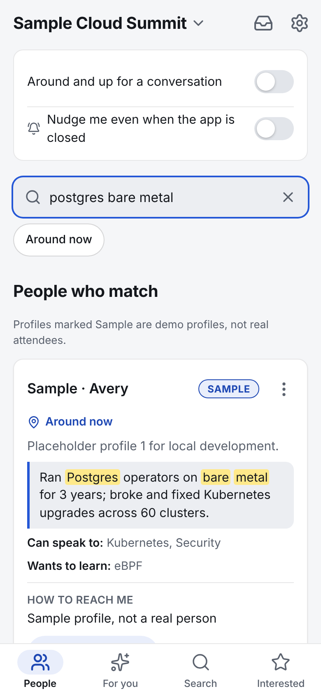
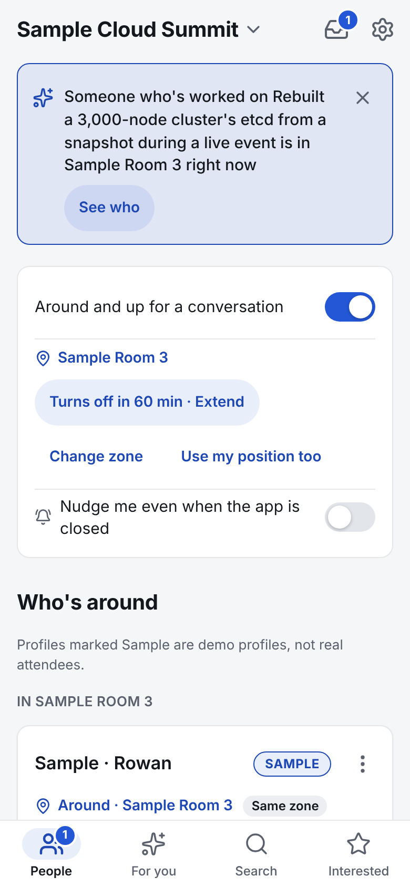
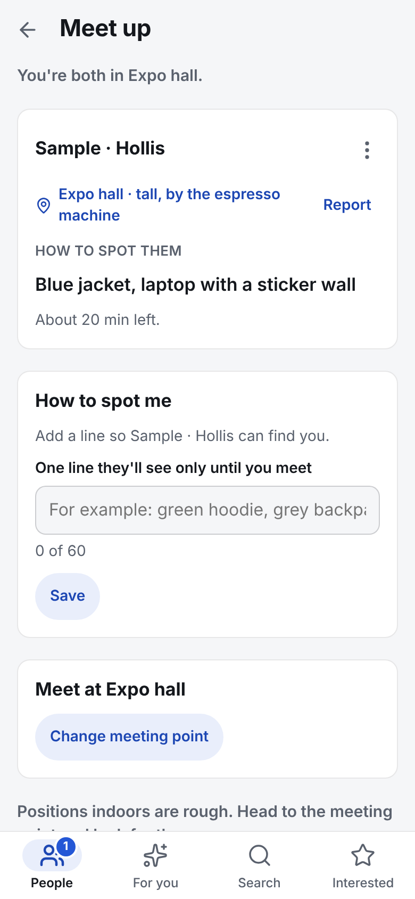
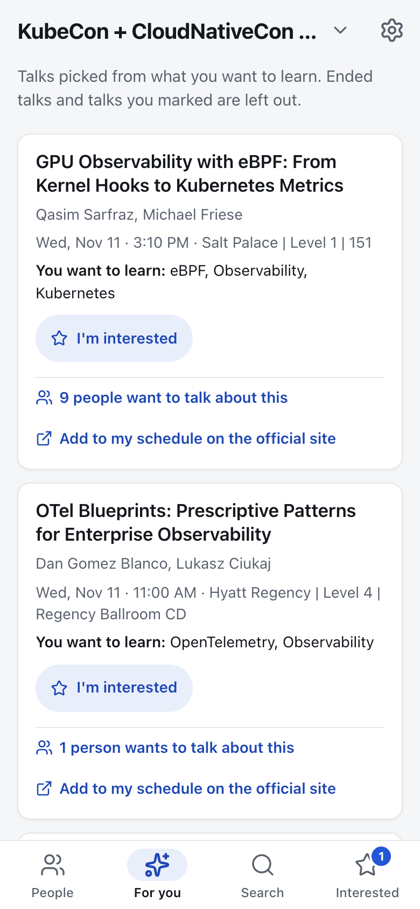

# Conference Caddie

Conference Caddie finds the people at a conference whose experience overlaps what you're working on or want to learn, and tells you when they're nearby. Turn on "Around," and the app nudges you when a strong match is in the same hall, so a coffee line becomes a conversation; or ask someone to talk shop and agree where to meet. It also suggests talks that match your interests. It leaves schedules, attendee lists and messaging to Sched and the official conference tools.

It runs as a web app (PWA) on any phone, and as an Android app (.apk) that adds Bluetooth: **only the Android app uses Bluetooth**; the web app finds people nearby by zone and, optionally, GPS.

<p>
  
  
  
  
</p>

## Install

**On your phone (web app).** Open `https://conference-caddie.<subdomain>.workers.dev/`, the free app served by the Cloudflare Worker, or scan the QR code for KubeCon + CloudNativeCon North America 2026. The address is a placeholder until the Worker is live: `worker/scripts/deploy.sh` prints the real one, and the QR code is regenerated for it after the deploy (see [docs/FREE_HOSTING.md](docs/FREE_HOSTING.md)). To get nudges with the app closed, add it to your Home Screen (iPhone: Share, then Add to Home Screen; Android: the install prompt) and turn on "Nudge me even when the app is closed". No account is needed.


**On Android with Bluetooth (.apk).** Download the latest debug APK from the [Android APK workflow](https://github.com/KurtLehnardt/conferenceCaddie/actions/workflows/android-apk.yml) (open the newest successful run, then Artifacts; GitHub sign-in required), unzip it, open the `.apk` on the phone and allow installs from your browser. Or from a computer: `gh run download <run-id> --repo KurtLehnardt/conferenceCaddie && adb install -r */*.apk`. Bluetooth proximity needs Android 8.0 or later with Bluetooth 5 extended advertising; building it yourself is described in [docs/ANDROID.md](docs/ANDROID.md).

**Run it locally (no keys, sample data).**

```sh
npm --prefix web ci
VITE_MOCK=1 npm --prefix web run dev     # http://localhost:5173 with fixture conferences and sample people
```

The older Cloud Run address, https://conference-caddie-265846417372.us-west1.run.app, stays up until the paid stack is shut down; see [docs/FREE_HOSTING.md](docs/FREE_HOSTING.md) for the plan and the status of the move.

**Run it for free (no expiry).** The free stack is one Cloudflare Worker (`worker/`) that serves the web app as static assets and the API on the same origin, keeps everything in SQLite-backed Durable Objects and uses Workers AI for embeddings. GitHub Pages publishes only the public talk bundles. It needs no Elasticsearch and no Google Cloud. [docs/FREE_HOSTING.md](docs/FREE_HOSTING.md) describes the architecture, the free limits, how the app degrades and the operations runbook, and [worker/README.md](worker/README.md) has the deploy steps.

**Run your own server (Cloud Run and Elasticsearch).** Node 22 or later, an Elasticsearch deployment, and Google Cloud Run for the hosted service:

```sh
npm ci && npm --prefix web ci
export ES_URL="https://<your-deployment>.es.io:443"   # required: the scripts default to the maintainer's cluster otherwise
ELASTISEARCH_API_KEY="$ELASTISEARCH_API_KEY" npm run es:setup         # talks, conferences, topics
ELASTISEARCH_API_KEY="$ELASTISEARCH_API_KEY" npm run people:setup     # people, presence, meets, blocks
ELASTISEARCH_API_KEY="$ELASTISEARCH_API_KEY" npm run ingest -- --event kubecon-cloudnativecon-north-america-2026
npm run deploy                                                          # Cloud Run; see the checklist for every step
```

Set `ES_URL` before running any of the scripts, because they fall back to the maintainer's Elasticsearch cluster and would send your API key there. `scripts/deploy.sh` hard-codes `PROJECT`, `REGION` and `ES_URL` for the maintainer's deployment (the service name comes from `SERVICE`, default `conference-caddie`), so edit `PROJECT`, `REGION` and `ES_URL` in that file before you run `npm run deploy`.

[docs/OPERATOR_CHECKLIST.md](docs/OPERATOR_CHECKLIST.md) lists every setup step in order (reports, moderation rules, push keys, the smoke test), with the environment variables each one reads.

## How people find each other

| | Web app (PWA) | Android app (.apk) |
|---|---|---|
| Find people by what they've built or want to learn | yes | yes |
| "Around": pick a zone (a room, Expo hall, Registration, Food and coffee, Hallway, Outside) | yes | yes |
| GPS position as a ranking signal, shown to others only as a band (same zone, near, around) | yes, optional | yes, optional |
| Nudge when a strong match is in your zone | in the app; by push when installed to the Home Screen | yes |
| Bluetooth: a notification when an opted-in strong match is within a few metres, phone in pocket | **no** (browsers cannot advertise over Bluetooth) | **yes** |
| Ask to talk shop, Wave, meet-up with a meeting point and "how to spot me" | yes | yes |

Asks are now-only: you can ask someone who is around, they have 15 minutes to answer, and accepting means now. Someone who isn't around can be watched, and the app tells you when they turn up. Nothing is booked in advance.

What is shared, with whom, for how long: your profile text, to people visible at that conference, until its last day; your zone, only to people who are also around, only while you are; how to spot you and a rough distance, only to the one person you accepted, only until you meet; the Bluetooth code, to nobody but the server, for ten minutes at a time. Nothing about where you were is kept. Block is symmetric and silent; Report hides a profile after two reports; short texts pass a filter. There is no sign-in: a random device secret, stored only as a hash, protects your profile, and "Delete my profile" removes it at once.

## Everything else it does

- **For you**: talk suggestions from your topics and free text, with the matching passage shown.
- **Search**: hybrid keyword and semantic search over the conference's talks, with filters for day, time, track and the conference's own tags. **Schedule** shows the whole conference a day at a time.
- **Talk circles**: mark a talk "I'm interested" and, separately, share your profile with others interested in it.
- **My schedule**: the talks you marked, as a list or a day timeline, kept on your device. It is a view, not a planner.
- **Import my schedule** (Settings): a PDF, CSV, text, .ics or JSON schedule from anywhere, matched to the conference's real talks. The file is read once and never stored.
- **Import from GitHub** (Profile): proposes "things I've built" text and topics from your public repositories; nothing is stored until you accept it.
- **Offline**: after one visit, the schedule and keyword search work without a connection.

## How it works

- Conference schedules are committed snapshots of public Sessionize feeds. Nothing is fetched at runtime.
- Conferences are discovered from the Linux Foundation events list (`events.linuxfoundation.org`), which names each event's schedule page; the page carries the Sessionize feed to read. Only the operator runs ingestion, from the CLI.
- Elasticsearch is the only data store and does all matching, ranking and filtering: lexical plus `semantic_text` retrievers fused with reciprocal rank fusion for search, people and suggestions. No generative model is used.
- Embeddings come from the E5 small model running on the Elasticsearch deployment's own ML node (inference endpoint `caddie-e5-small`). If embedding fails for any reason, search, suggestions and people matching fall back to keyword matching for a minute and the app says so; profiles still save.
- Each conference's topic list is built from its talk titles at ingestion, with an Elasticsearch analyzer and aggregation.
- One Node.js service on Cloud Run serves the app and the API. It runs as the dedicated `caddie-runtime` service account, which can read only the secrets `scripts/deploy.sh` mounts and has no project-level roles. Those are two scoped Elasticsearch keys (a read-only key for talks, conferences and topics, and a people key that can only read and write the `caddie-people*` indices), the VAPID private key that signs push nudges, and optionally a read-only GitHub token for the profile import. The text classifier uses the service account's own token; no key. `docs/OPERATOR_CHECKLIST.md` lists the operator steps in order.

- The Android companion (`web/android/`, see `docs/ANDROID.md`) is the same web app in a Capacitor shell plus one Bluetooth plugin; the debug APK is built by the GitHub Actions workflow on `android/**` branches. The web app and the companion share one API, one server and one set of storage keys.

## Adding a conference

With `ELASTISEARCH_API_KEY` set to an admin-capable key:

```sh
npm run ingest -- --list                 # upcoming Linux Foundation events and their platform
npm run ingest -- --event <slug>         # ingest one event and build its topics
npm run ingest -- --all-upcoming         # every upcoming event whose schedule is on Sessionize
npm run topics -- --event <slug>         # rebuild one event's topic list, for example after editing its fix-up file
node scripts/build-facets.mjs [<slug> ...]  # rebuild the track, room, speaker and tag names used for suggested chips; run it after ingesting
```

Re-running is safe: unchanged talks are not re-embedded. Events on other platforms, or with no published schedule, appear in the switcher as "Schedule not available here yet". Per-conference topic fix-ups (rename, merge, remove) live in `data/topics/{slug}.json`; the shared stoplist is `config/topic-stoplist.txt`.

For the API and index shapes, see [docs/CONTRACT.md](docs/CONTRACT.md). Design choices are recorded in [DECISIONS.md](DECISIONS.md). The plan for native Android and iOS apps, with deployment tiers that cost nothing to run, is in [docs/NATIVE_PLAN.md](docs/NATIVE_PLAN.md).

The app began as an entry in the Elasticsearch "Find the Right Talk" track at a hackathon during KubeCon + CloudNativeCon North America 2026.

## License

Apache License 2.0. See [LICENSE](LICENSE).

The license covers the code and documentation written in this repository. It does not cover the schedule snapshots: `data/raw/**`, the talk and speaker text in `data/*/talks.ndjson`, and any other copied schedule content under `data/` are snapshots of public conference schedules, copyright their owners. Linux Foundation site content is available under CC BY 3.0 (https://www.linuxfoundation.org/legal/terms); session and speaker content is copyright the speakers and organizers. See [NOTICE](NOTICE) for these and for the third-party files `config/moderation-words.json` and `data/windows-zones.json`.
